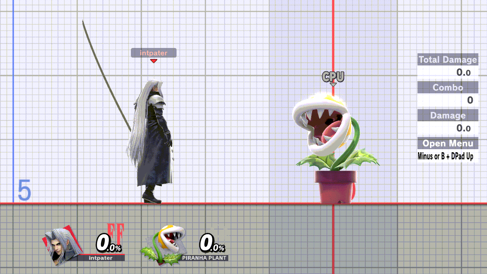

# ssbu-memory-guard

> **Disclaimer:** this project was developed with the assistance of AI
> (Claude, Codex and other coding agents) under the operator's direction and
> review. Nothing is claimed beyond the dated tests cited below.

A Skyline plugin for Super Smash Bros. Ultimate 13.0.5 (`libmemory_guard.nro`).
Five crashes on the operator's Switch came from a pointer that had one stray
bit. At the seven places in the game's code behind them, this plugin checks
the pointer just before the game reads it and puts it back: a real address
with one extra high bit loses that bit, and an empty pointer that gained one
bit becomes empty again, so the game takes its normal path. Anything it
cannot put right is logged and left alone. It also records why the game's
heap failed to give memory back when that failure makes the game abort.



*Eden, 2026-11-02, run q03: the card's 16 plugins, the tile cursor and this
plugin's diagnostic build (`9aeca255`). A stray bit was planted once at each
of the seven places; each was repaired, and Training ran on with the CPU
Pilot driving P1.*

- **Only values the game would crash on.** A pointer the game can read is
  never touched.
- **Seven places,** from five crash reports on the card: the render
  dispatcher's command-buffer list, a component getter, a list walk, a field
  getter and a hash-table rehash.
- **Refused memory releases:** when the system refuses to take memory back
  and the game aborts, the plugin first writes what the system answered.
- **Guarded:** it changes nothing unless the game is 13.0.5, and it leaves
  alone any place whose code is not the code it expects.
- **Cost:** 64 KiB of game memory, no heap use.

**Tested** in Eden on 2026-11-02: planted stray bits were repaired at all
seven places; without the repair, the same plants made the game read the
addresses two console crashes faulted on; a forced refusal was recorded; a
LAN Online match ended with no desync. On the operator's Switch since
2026-11-02: a card read on 2026-11-03 showed it installed at every place,
with no repair, refusal or abort logged yet. Details: [docs/EVIDENCE.md](docs/EVIDENCE.md); how it
works and what it logs: [docs/HOW-IT-WORKS.md](docs/HOW-IT-WORKS.md).

**0.2.0** also records why the system refused to commit memory pages when
the game aborts on that (the console hang of 2026-11-13 ended there). It
is **untested on hardware (Eden-tested only; installed on the card, not
yet played)**. In Eden on 2026-11-13 a forced refusal was recorded as one
line, and the release build ran Training cleanly with the card's plugins.

## Install

[Download 0.2.0](https://git.syntaxbyexample.com/intpa/ssbu-memory-guard/releases/tag/v0.2.0)
(untested on hardware; [0.1.0](https://git.syntaxbyexample.com/intpa/ssbu-memory-guard/releases/tag/v0.1.0)
is the previous release) and copy `libmemory_guard.nro` to
`sd:/atmosphere/contents/01006A800016E000/romfs/skyline/plugins/`.

## Build

```text
cargo test
cargo skyline build --release
cargo skyline build --release --features diag   # Eden: hit counts, planted faults (diag.txt)
```

`src/guards.rs` is generated from the decompressed 13.0.5 main image (file
offset = text offset + 0x100): `python3 -I tools/guard_table.py <main.uncompressed> > src/guards.rs`.

## License

MIT
